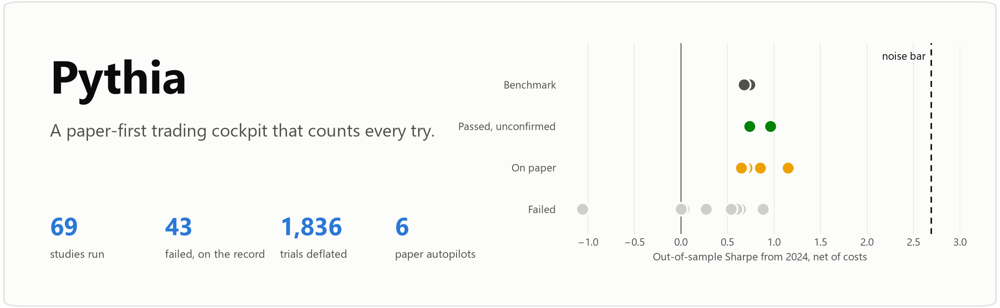
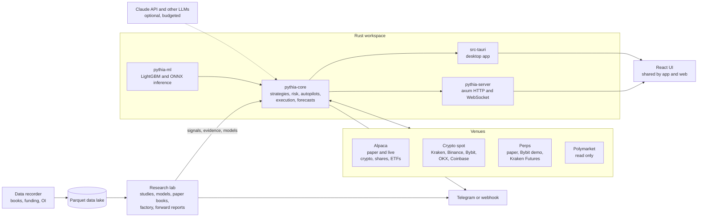

<div align="center">



**A paper-first trading cockpit with a research lab that is allowed to say no.**

[](https://www.rust-lang.org)
[](https://v2.tauri.app)
[](https://react.dev)
[](https://www.typescriptlang.org)
[](research/lab/README.md)
[](SAFETY.md)
[](CHANGELOG.md)

[What it is](#what-it-is) · [Results](#honest-results) · [Architecture](#architecture) · [Quickstart](#quickstart) · [Safety](#safety) · [Changelog](CHANGELOG.md)

</div>

---

## What it is

Pythia is a trading cockpit that starts on paper and stays there until a strategy has earned more.

- **One Rust engine** (`pythia-core`) holds the strategies, the risk manager, the autopilots and the order lifecycle. The same engine runs inside the **Tauri desktop app** and behind a **standalone server** with a **React web UI**.
- **Autopilots** trade an amount on their own until you stop them: on the **Alpaca paper account** for crypto, US shares and ETFs, and on **perps paper** (or a Bybit demo account) for the long/short books. Several run side by side, each with its own book, all held against BTC.
- **A research lab** in Python decides what the autopilots may trade. Every study is **pre-registered** before its first number, judged **out of sample** after costs, and **deflated** for every try ever made. Most ideas fail, and the failures are kept.
- **Models** (volatility, coin ranking, return quantiles and more) go from the lab to the engine with train/serve parity, in shadow first.
- **Alerts** reach you on **Telegram** (or any webhook) as readable cards, in English or German.

> [!WARNING]
> Pythia is not financial advice and no strategy in it is known to be profitable. It ships in paper mode. Read [`SAFETY.md`](SAFETY.md) before you connect a real account.

## Highlights

| | |
|---|---|
| 🧭 **Autopilots**<br>An amount that trades a lab book until a stop rule fires. Side-by-side view, re-pick by evidence, portfolio mode across crypto and US shares, every run held against BTC and BTC above its 200-day average. | 🔬 **Honest research lab**<br>Pre-registered studies, purged walk-forward, costs in every number, a deflated Sharpe over a pool of 1,836 trials, a strategy factory that breeds rules and holds them to the same bar. |
| 🛡️ **Sovereign risk manager**<br>Kill switch, daily-loss and drawdown breakers, correlation-aware exposure caps, volatility targeting, sizing on measured edge. Fails closed. | 📈 **Paper and demo on real venues**<br>Alpaca paper (crypto, shares, ETFs), crypto demo routes, perps on paper or Bybit demo with funding per position, paper fills that walk the live order book. |
| 🧠 **Models and forecasts**<br>LightGBM and ONNX inference in Rust, a model zoo with champion and challenger, scored prediction ensembles. Bring any LLM for signals; the Claude API can add a budgeted daily brief, news sentiment and a Polymarket forecaster. | 🔔 **Alerts and reports**<br>Telegram cards for fills, rebalances and readiness, a daily digest with charts, a weekly report, quiet hours, mute that survives a restart. |
| 🗂️ **Data recorder**<br>Order books, funding, open interest and liquidations recorded 24/7, plus verified history backfills, into a parquet lake the lab reads. | 🖥️ **Calm UI**<br>A simple view for people who have never traded, an advanced view with every instrument, light and dark themes, phone layout. |

## Screenshots

<table>
  <tr>
    <td width="50%"><br><sub><b>Home</b>: what your autopilots are worth, and a big stop button.</sub></td>
    <td width="50%"><br><sub><b>Autopilot</b>: several side by side, each against BTC and gated BTC.</sub></td>
  </tr>
</table>
<sub>Captured from a development build with sample data (the page says so).</sub>

## Architecture



The engine never trusts a strategy on its word: a lab book reaches an autopilot only with its evidence attached, the auto pick ranks books by that evidence and the forward record, and an experimental book runs only where an autopilot names it.

## Honest results

Every number below comes from the lab's result files or the engine's own records and is redrawn by [`scripts/readme_charts.py`](scripts/readme_charts.py), which names the source of each bar.


- **The best book, a Donchian breakout on the ten most liquid coins, makes Sharpe 1.17 from 2024** against 0.74 for BTC bought and held. It still fails deflation: with 1,836 tries counted, the best pure-noise trial would show about 2.69.
- **Two perps long/short studies passed their registered tests** (the M4 residual and a funding carry), but neither survives deflation, so both run only as experiments.
- **Most of the momentum books are BTC's 200-day gate in disguise**: on the days the gate is off, every book loses money.


The paper autopilots have run since 15 October 2026. Six days in, the main Auto-Pick is up 0.48 % while BTC rose 3.22 %. That is far too short to judge, and the daily forward report says so; the chart is here so the record is public from the start.


69 studies so far: 43 failed or were killed, 7 run on paper as labelled experiments, 2 passed as registered without confirmation, 5 produced a model that beats its baseline. The full list with every verdict is in [`research/lab/README.md`](research/lab/README.md).


<details>
<summary>Redraw the charts</summary>

```bash
pip install matplotlib
PYTHIA_DATA=/path/to/lab/data python scripts/readme_charts.py
```

Without `PYTHIA_DATA` the forward chart is skipped and the others are drawn from the repository alone.
</details>

## Quickstart

You need Node.js (current LTS), a stable Rust toolchain (1.85 or newer) and, for the lab, a recent Python 3.

**Desktop app**

```bash
npm install
npm run tauri dev       # development window with hot reload
npm run tauri build     # installer and executable under src-tauri/target/release/bundle/
```

**Server and web UI**

```bash
cp .env.example .env    # keys are optional; without them everything stays on paper
npm run server          # engine on http://localhost:8787 (PYTHIA_BIND to change)
```

```bash
echo "VITE_PYTHIA_SERVER=http://localhost:8787" > .env.local
npm run dev             # web UI on http://localhost:5174
```

Without `VITE_PYTHIA_SERVER` the web UI runs its own TypeScript paper engine in the browser, no keys needed.

**Research lab**

```bash
cd research/lab
python -m venv .venv && . .venv/bin/activate
pip install -r requirements.txt
python -m pytest tests
PYTHIA_DATA=/path/to/data PYTHIA_REPORTS=/tmp/pythia-reports PYTHIA_RESULTS=results python -m lab.experiments.gated_btc
```

The data comes from the recorder (`research/recorder`, Docker) and its history backfill. See [`research/lab/README.md`](research/lab/README.md) for every study and [`research/ops/README.md`](research/ops/README.md) for the job table.

**Checks**

```bash
npm run check           # cargo tests, vitest and the production build
npm run preflight       # names what blocks a paper or live run
```

On Windows the npm scripts strip `CC` and `CXX` from the environment, because paths with spaces break native Rust builds.

## Project layout

| Path | What lives there |
|---|---|
| [`crates/pythia-core`](crates/pythia-core) | The engine: strategies, indicators, risk, autopilots, execution, venues, forecasts, alerts |
| [`crates/pythia-ml`](crates/pythia-ml) | Model inference (LightGBM, ONNX) with parity tests against the lab |
| [`server`](server) | Standalone backend: axum HTTP and WebSocket over the engine |
| [`src-tauri`](src-tauri) | Desktop shell (Tauri v2) over the same engine |
| [`src`](src) | React UI; [`src/design`](src/design/README.md) is the design system |
| [`research/lab`](research/lab/README.md) | Studies, models, paper books, strategy factory, forward reports |
| [`research/recorder`](research/recorder/README.md) | 24/7 market data recorder and history backfill |
| [`research/ops`](research/ops/README.md) | Job table, health checks, deploy scripts |
| [`docs`](docs) | Runbooks: [demo trading](docs/DEMO.md), [live run](docs/LIVE-RUN.md), [alerts](docs/ALERTS.md), [models](docs/MODELS.md), [forecasting](docs/FORECASTING.md), [Claude API use](docs/AI.md), [readiness rule](docs/LIVE-READINESS.md) |
| [`scripts`](scripts) | Preflight, validation, screenshots, README charts |
| [`PROFIT-PLAN.md`](PROFIT-PLAN.md) | What a strategy must prove before real money, gate by gate |

## Safety

- **Paper first.** A fresh install trades nothing real. Autopilots start on paper or a venue's demo account.
- **Real money only when the owner arms it.** Live trading needs your own keys and a typed confirmation per venue; nothing arms itself. The pre-registered [readiness rule](docs/LIVE-READINESS.md) only tells the owner when a paper record qualifies for a proposal. The kill switch and every risk limit gate each order.
- **No keys in the repository.** Keys live in the OS keychain (desktop) or the server's environment, are never logged and never returned to the UI. [`.env.example`](.env.example) lists the names, not the values.
- **No withdrawals.** Pythia has no withdrawal, deposit or transfer function. Give API keys trade permission only, so a leaked key costs a rotation, not your money.
- **Crypto spot is long-only**, shorts exist only on perps, and Polymarket is read only.

[`SAFETY.md`](SAFETY.md) is the full list, including the one capped, owner-only wallet exception.

## License and credits

[MIT](LICENSE). Built by [SenseiIssei](https://github.com/SenseiIssei). Market data from Alpaca, Binance, Kraken, Bybit, OKX, Coinbase, Deribit, DefiLlama, Polymarket and public SEC filings; each venue's terms apply to its data.

If Pythia is useful to you, you can [support it on Ko-fi](https://ko-fi.com/senseiissei).
