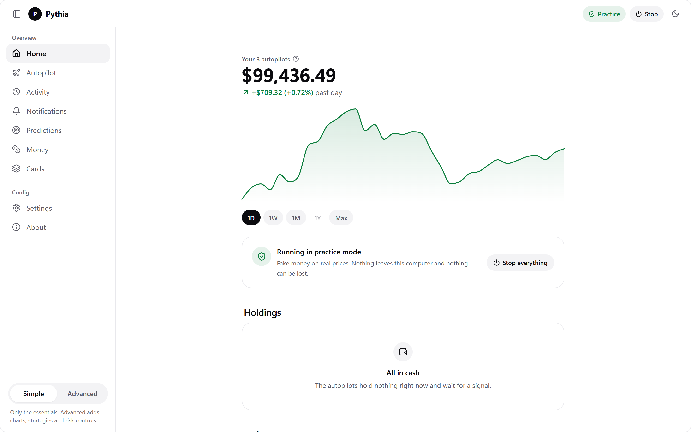
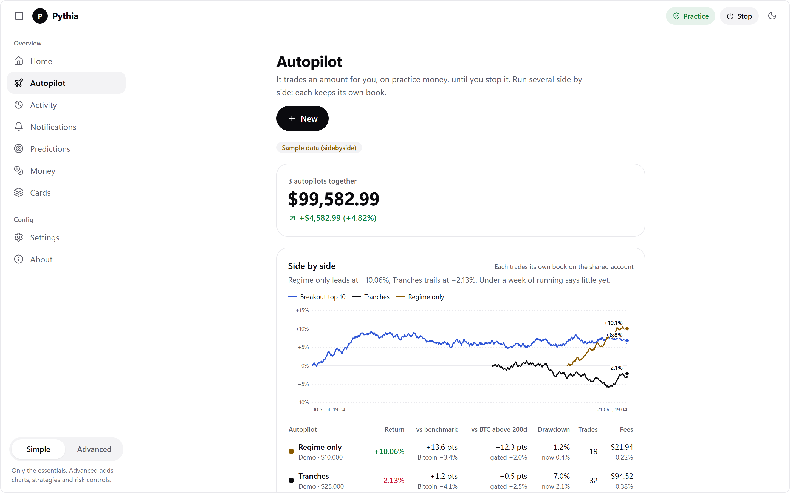
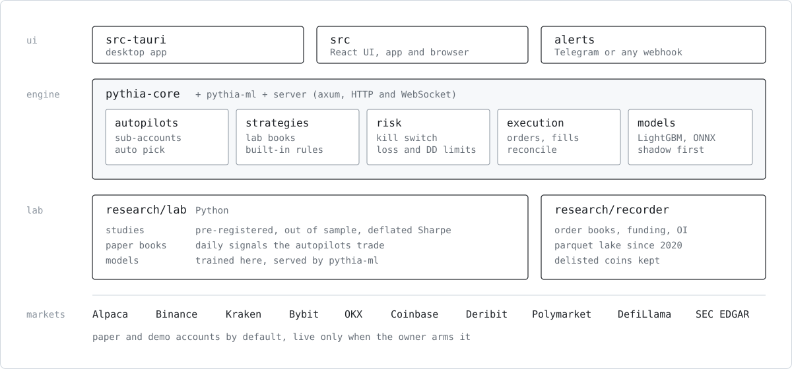
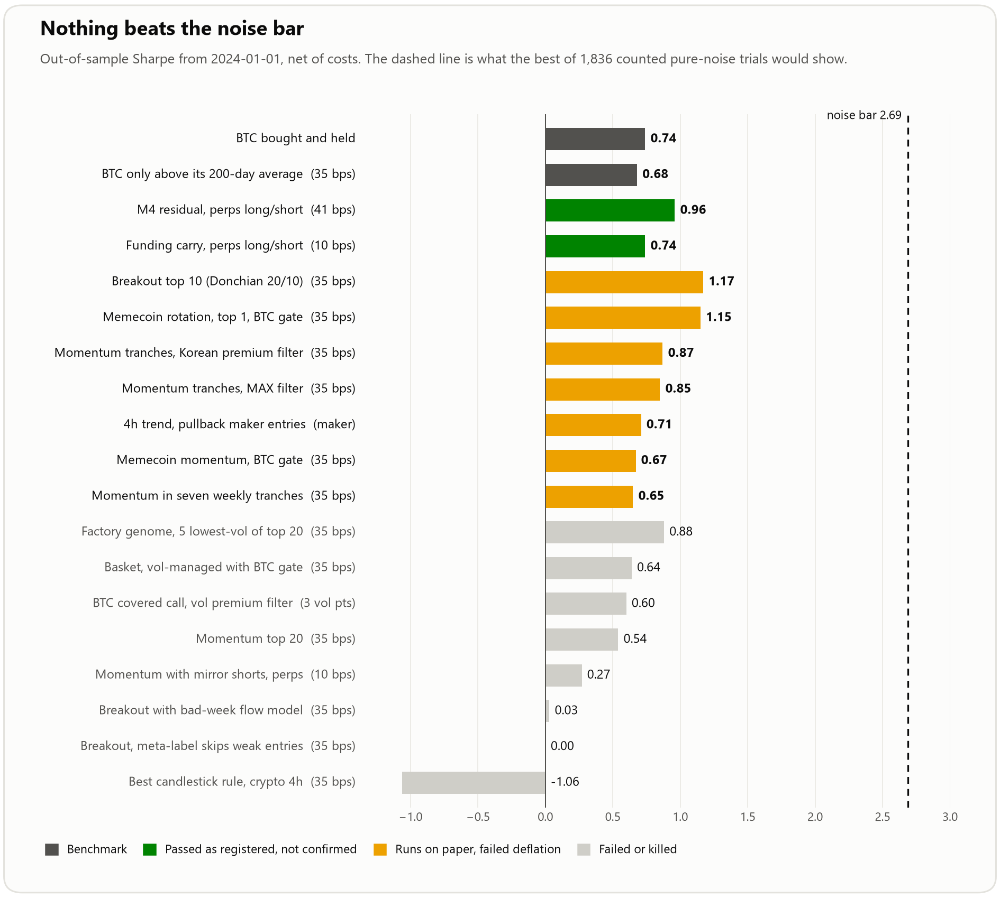
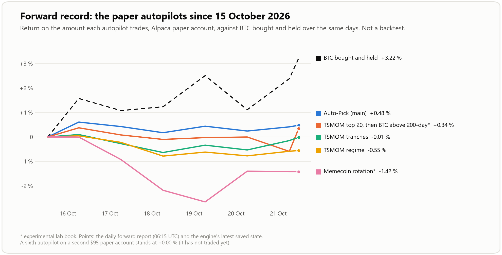
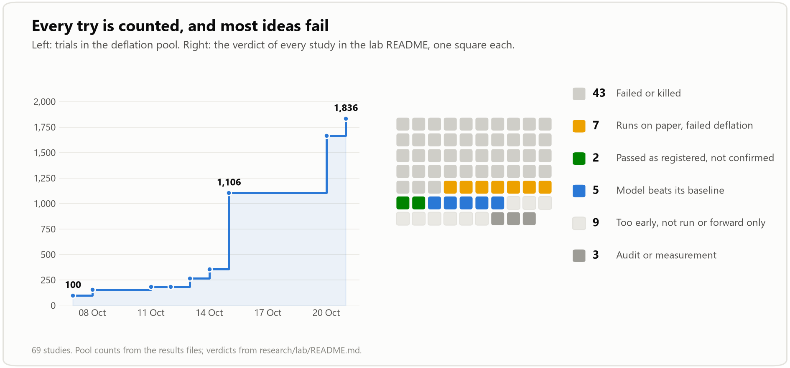
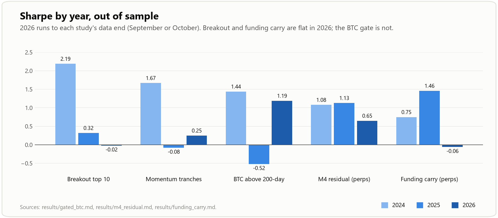

# Pythia

[English](../../README.md) · [Deutsch](README.de.md) · [简体中文](README.zh-CN.md) · [日本語](README.ja.md) · [한국어](README.ko.md) · [Español](README.es.md) · Français · [Português](README.pt-BR.md)

Pythia est un cockpit de trading qui commence sur papier et y reste tant qu'une stratégie n'a pas fait ses preuves. Il comprend un moteur en Rust, une application de bureau et une interface web par-dessus, et un laboratoire de recherche en Python qui décide de ce que le moteur peut trader. Le laboratoire compte chaque idée qu'il a essayée, pour qu'un backtest chanceux ne passe pas entre les mailles.

Aucune stratégie ici n'est connue pour être rentable. Lisez [SAFETY.md](../../SAFETY.md) (en anglais) avant de connecter un vrai compte.

<table>
  <tr>
    <td width="50%"></td>
    <td width="50%"></td>
  </tr>
</table>

Captures d'une version de développement avec des données d'exemple.

## Téléchargement

La [dernière version](https://github.com/SenseiIssei/Pythia/releases/latest) contient :

| Plateforme | Fichier |
|---|---|
| Windows | `Pythia_<version>_x64-setup.exe` |
| macOS (Apple silicon et Intel) | `Pythia_<version>_universal.dmg` |
| Linux | `.AppImage`, `.deb` ou `.rpm` |
| Ligne de commande | `pythia-cli-<version>-<plateforme>` : `pythia` et le moteur sans fenêtre `pythia-server`, voir [cli/README.md](../../cli/README.md) (en anglais) |

Les versions ne sont pas encore signées. Windows demande une fois (Informations complémentaires, puis Exécuter quand même) ; sur macOS, la première fois, faites un clic droit sur l'application et choisissez Ouvrir.

## Ce qu'il fait

- Un autopilote est un montant qui trade une stratégie tout seul jusqu'à ce que vous l'arrêtiez ou qu'une règle d'arrêt se déclenche. Plusieurs tournent côte à côte, chacun mesuré face au BTC.
- Crypto, actions américaines et ETF sont tradés sur le compte papier d'Alpaca. Les portefeuilles long/short tradent des perpétuels sur papier, ou sur un compte démo Bybit si vous ajoutez des clés de démo.
- Le gestionnaire de risque se place devant chaque ordre : arrêt d'urgence, limites de perte journalière et de drawdown, plafonds d'exposition, ciblage de volatilité. Dans le doute, il refuse.
- Chaque étude du laboratoire est enregistrée avant sa première exécution, testée hors échantillon après coûts, et son Sharpe est corrigé du nombre total d'essais effectués (deflated Sharpe).
- Les modèles (volatilité, classement des cryptos, quantiles de rendement) sont entraînés dans le laboratoire et exécutés par le moteur. Ils tournent d'abord en mode fantôme avant de pouvoir influencer un trade.
- Les alertes arrivent sur Telegram ou n'importe quel webhook, en anglais ou en allemand.

## Architecture



Un portefeuille du laboratoire n'arrive à un autopilote qu'accompagné de ses preuves. La sélection automatique classe les portefeuilles selon ces preuves et leur historique réel, et un portefeuille expérimental ne tourne que là où un autopilote le demande nommément.

## Résultats à ce jour

Tous les chiffres viennent des fichiers de résultats du laboratoire ou des enregistrements du moteur. [`scripts/readme_charts.py`](../../scripts/readme_charts.py) dessine chaque graphique ci-dessous et en cite les sources.



Le meilleur portefeuille est une cassure de Donchian sur les dix cryptos les plus liquides : Sharpe de 1,17 depuis 2024, contre 0,74 pour la simple détention de BTC. Il ne passe pourtant pas la correction. Avec 1 836 essais comptés, la meilleure d'autant de stratégies de pur bruit afficherait environ 2,69.

Deux études long/short sur perpétuels ont passé leurs tests enregistrés (le résidu M4 et un carry de funding). Aucune ne survit à la correction, donc les deux tournent uniquement comme expériences. La plupart des portefeuilles momentum ne sont en fait que le filtre 200 jours du BTC déguisé : les jours où le filtre est éteint, tous perdent de l'argent.



Les autopilotes papier ont démarré le 15 octobre 2026. Après six jours, la sélection automatique principale gagne 0,48 % et le BTC 3,22 %. C'est bien trop court pour signifier quoi que ce soit ; le graphique est là pour que l'historique soit public dès le premier jour.



69 études à ce jour : 43 ont échoué ou ont été arrêtées, 7 tournent sur papier comme expériences signalées, 2 ont réussi comme prévu sans confirmation, 5 ont produit un modèle qui bat sa référence. Chaque verdict est listé dans [`research/lab/README.md`](../../research/lab/README.md).



Pour redessiner les graphiques :

```bash
pip install matplotlib
PYTHIA_DATA=/path/to/lab/data python scripts/readme_charts.py
```

Sans `PYTHIA_DATA`, le graphique de l'historique réel est ignoré.

## Démarrer

Il faut Node.js (LTS actuelle), Rust 1.85 ou plus récent et, pour le laboratoire, Python 3.

Application de bureau :

```bash
npm install
npm run tauri dev
npm run tauri build
```

Serveur et interface web :

```bash
cp .env.example .env
npm run server
```

```bash
echo "VITE_PYTHIA_SERVER=http://localhost:8787" > .env.local
npm run dev
```

Le serveur écoute sur `127.0.0.1:8787` (`PYTHIA_BIND` pour changer). Les clés dans `.env` sont facultatives ; sans elles tout reste sur papier. Sans `VITE_PYTHIA_SERVER`, l'interface web fait tourner un petit moteur papier dans le navigateur.

Laboratoire :

```bash
cd research/lab
python -m venv .venv && . .venv/bin/activate
pip install -r requirements.txt
python -m pytest tests
```

Les données viennent de l'enregistreur dans `research/recorder` et de son historique rechargé. [`research/lab/README.md`](../../research/lab/README.md) liste chaque étude, [`research/ops/README.md`](../../research/ops/README.md) les tâches planifiées.

Vérifications :

```bash
npm run check
npm run preflight
npm run security:scan
```

Sous Windows, les scripts npm retirent `CC` et `CXX` de l'environnement, car les chemins avec des espaces cassent les compilations natives Rust.

## Arborescence

| Chemin | Contenu |
|---|---|
| [`crates/pythia-core`](../../crates/pythia-core) | Moteur : stratégies, risque, autopilotes, exécution, plateformes, prévisions, alertes |
| [`crates/pythia-ml`](../../crates/pythia-ml) | Inférence des modèles (LightGBM, ONNX) avec tests de parité face au laboratoire |
| [`server`](../../server) | Serveur HTTP et WebSocket au-dessus du moteur |
| [`cli`](../../cli/README.md) | Ligne de commande `pythia` |
| [`src-tauri`](../../src-tauri) | Application de bureau |
| [`src`](../../src) | Interface React |
| [`research/lab`](../../research/lab/README.md) | Études, modèles, portefeuilles papier, fabrique de stratégies |
| [`research/recorder`](../../research/recorder/README.md) | Enregistreur de données de marché et historique |
| [`research/ops`](../../research/ops/README.md) | Table des tâches, contrôles de santé, scripts de déploiement |
| [`docs`](..) | Guides pour le [trading démo](../DEMO.md), le [trading réel](../LIVE-RUN.md), les [alertes](../ALERTS.md), les [modèles](../MODELS.md), [l'API Claude](../AI.md) et la [règle de préparation](../LIVE-READINESS.md) (en anglais) |

## Sécurité

- Une installation neuve ne trade rien de réel. Les autopilotes démarrent sur papier ou sur le compte démo d'une plateforme.
- Le trading réel exige vos propres clés et une confirmation saisie pour chaque plateforme. Rien ne s'active tout seul.
- Les clés sont stockées dans le trousseau du système ou dans l'environnement du serveur, jamais journalisées ni envoyées à l'interface.
- Pythia n'a aucune fonction de retrait, de dépôt ou de virement. Ne donnez aux clés d'API que le droit de trader.
- Le spot crypto est uniquement long, les ventes à découvert n'existent que sur les perpétuels, Polymarket est en lecture seule.

La liste complète est dans [SAFETY.md](../../SAFETY.md). Les problèmes de sécurité se signalent selon [SECURITY.md](../../SECURITY.md).

## Licence

[MIT](../../LICENSE). Données de marché d'Alpaca, Binance, Kraken, Bybit, OKX, Coinbase, Deribit, DefiLlama, Polymarket et SEC EDGAR ; les conditions de chaque source s'appliquent à ses données. Si Pythia vous est utile, vous pouvez [le soutenir sur Ko-fi](https://ko-fi.com/senseiissei).
